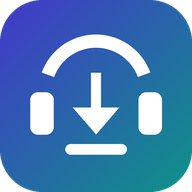
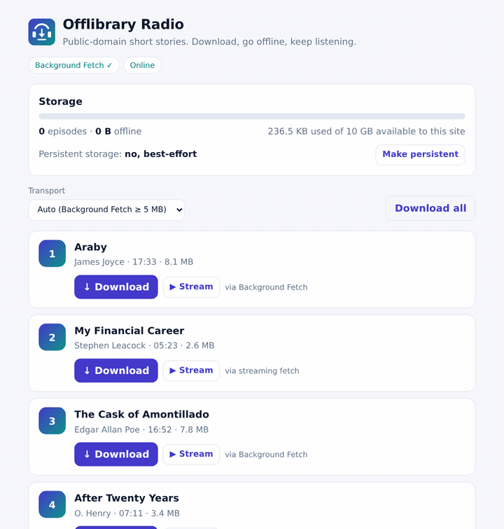
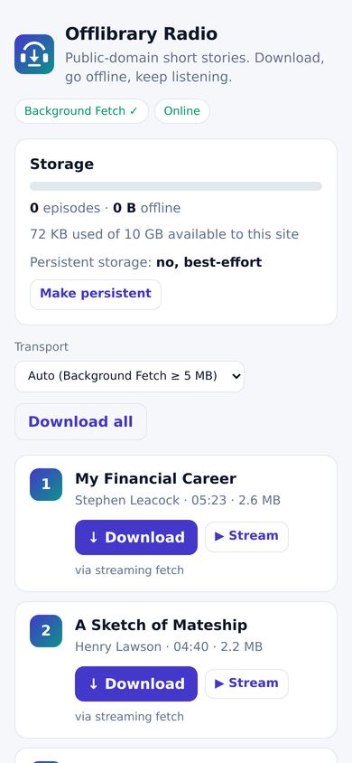

<div align="center">



# Offlibrary

**Declarative offline asset management for the web.**
Download podcasts, video lessons, map tiles or AI models with one call. Background Fetch when the browser has it, a resumable streaming fallback when it doesn't, with quota, eviction and offline seeking built in.

[](https://github.com/webmaxru/offlibrary/actions/workflows/ci.yml)
[](https://www.npmjs.com/package/offlibrary)
[](LICENSE)


**[Documentation](https://salnikov.no/offlibrary/)** · [Live demo](https://salnikov.no/offlibrary/demo/) · [Quick start](#quick-start) · [Workbox](#workbox) · [API reference](https://salnikov.no/offlibrary/api/readme/)



<sub>The demo app downloading four episodes: the 8 MB ones via Background Fetch, the small ones via streaming fetch. Recorded with Playwright against a throttled local server.</sub>

</div>

---

## Why

Making a file available offline on the web takes five APIs that don't know about each other: Background Fetch, service workers, the Cache API, IndexedDB and the Storage API. Then there are the edge cases nobody writes twice:

- re-attaching to a download after a reload;
- resuming a half-finished file;
- answering `Range` requests so `<audio>` can seek offline;
- staying under quota;
- falling back when the browser has no Background Fetch, which is every non-Chromium browser.

Offlibrary wraps all of it behind a **config object and one method**:

```js
const library = createOfflibrary({ collections: { episodes: { maxItems: 20 } } });

await library.collection('episodes').download({ id: 'ep-42', url: 'https://cdn.example.com/ep-42.mp3', title: 'Episode 42' });
// …later, offline:
audio.src = 'https://cdn.example.com/ep-42.mp3'; // served from the device, seeking included
```

## Features

- 🧾 **Configuration-first.** You describe *collections* (episodes, lessons, tiles…) and their policies once.
- 🛰️ **Background Fetch when available.** Downloads keep going after the tab or browser closes, with the browser's own progress notification. Offlibrary uses deterministic IDs and **re-attaches after reloads**.
- 🔁 **Resumable fallback everywhere else.** Streaming `fetch` with live progress (bytes, rate, ETA), pause/resume, cancel and retries with backoff. Checkpoints are append-only, and downloads **resume exactly with `Range` + `If-Range`**, even after a reload and through redirects to short-lived signed URLs.
- 🧠 **Built for large AI models.** `storage: 'opfs'` writes straight into the Origin Private File System and resumes in place; in a dedicated worker it uses `createSyncAccessHandle()` (1× disk writes). When a private window's storage refuses bytes (quota errors or silent short writes), `onStorageRefused: 'memory'` finishes the download in memory so the model still runs. `collection.bytes(id)` hands the file to onnxruntime-web.
- 🎧 **Offline media that seeks.** The service-worker module answers `Range` requests with `206 Partial Content` straight from the cache.
- 📦 **Storage management.** Quota pre-check, `navigator.storage.persist()`, per-collection `maxItems` / `maxBytes` with LRU eviction, and pinned items.
- 🧩 **Multi-file items.** A video + subtitles + thumbnail, or a map-tile pack, is one item with one progress bar.
- 🔐 **Integrity and versions.** SRI hashes (`sha256/384/512`) are checked before anything is kept; `sha256` is hashed while streaming (constant memory, survives resumes). A new `version` replaces the old copy.
- 🔔 **Typed events and `subscribe()`.** Shaped for `useSyncExternalStore`, signals or any store. Every tab, worker and the service worker share one state; a second tab follows a running download and takes over if the first one closes.
- 🧰 **First-class Workbox plugin.** `offlibrary/workbox` brings stored files into your Workbox routes and strategies.
- 🪶 **Dependency-free.** Written in TypeScript, ESM, tree-shakeable, about 17.5 KB gzipped on the page and about 5 KB in the service worker. Runs on pages, in dedicated workers and in service workers.

## Browser support

| Browser | Background Fetch | What Offlibrary does |
|---|---|---|
| Chrome, Edge, Opera, Samsung Internet (desktop + Android) | ✅ since 74 / 79 / 62 / 11 | Background Fetch: survives tab and browser close, system notification |
| Firefox (desktop + Android) | ❌ | Resumable streaming fetch |
| Safari (macOS, iOS) and every iOS browser | ❌ | Resumable streaming fetch |
| Android WebView | ❌ | Resumable streaming fetch |

**Requirements**

- Service worker, Cache API and IndexedDB. These are in every evergreen browser.
- Range serving and Background Fetch need the service-worker module.
- Without a service worker you still get downloads, progress and storage via the fetch transport.

Background Fetch is a Chromium-only [WICG draft](https://wicg.github.io/background-fetch/), so Offlibrary treats it as a progressive enhancement. Details and dated facts: [Browser support](https://salnikov.no/offlibrary/browser-support/).

## Quick start

```bash
npm install offlibrary
```

**1. In your page:**

```js
import { createOfflibrary } from 'offlibrary';

navigator.serviceWorker.register('/sw.js');

export const library = createOfflibrary({
  namespace: 'podcast',
  collections: {
    episodes: {
      maxItems: 20,                                   // keep the 20 most recently used
      ui: { icons: [{ src: '/icons/icon-192.png', sizes: '192x192', type: 'image/png' }] },
      clickUrl: (item) => `/episodes/${item.id}`,     // notification tap opens the episode
    },
  },
});

const episodes = library.collection('episodes');

library.on('progress', ({ item }) => render(item));   // item.progress is 0..1
library.on('complete', ({ item }) => toast(`${item.title} is ready offline`));
library.on('error', ({ item, error }) => console.warn(item.id, error.code));

downloadButton.onclick = () =>
  episodes.download({ id: ep.guid, url: ep.enclosure, title: ep.title, size: ep.length });
```

**2. In your service worker** (bundled with Vite, webpack, esbuild…). Using Workbox? See [Workbox](#workbox) instead.

```js
// sw.js
import { offlibrarySW } from 'offlibrary/sw';
offlibrarySW(); // stores Background Fetches, updates the notification, serves stored files with Range support
```

…or without a bundler:

```js
// sw.js
importScripts('https://cdn.jsdelivr.net/npm/offlibrary@0/dist/offlibrary-sw.iife.js');
offlibrary.offlibrarySW();
```

**3. Play it, online or offline.** Use the original URL; the service worker answers from the device when the file is stored:

```js
audio.src = ep.enclosure;
```

> **Cross-origin files** must be served with CORS (`Access-Control-Allow-Origin`), and should allow `Range` for resuming. Opaque responses are rejected with `opaque-response`, because they can't be measured, verified or range-served.

## How it works

```
                ┌───────────── page ──────────────┐            ┌──────── service worker ────────┐
download(item) ─▶ validate → size → quota/limits  │            │ offlibrarySW()                  │
                │ strategy?                       │            │                                 │
                │  ├─ Background Fetch ───────────┼── browser ─▶ backgroundfetchsuccess → cache    │
                │  │   (progress via registration)│  download  │   → IndexedDB → BroadcastChannel│
                │  └─ streaming fetch → cache     │            │ fetch: Range → 206 from cache   │
                │       (segments in IndexedDB)   │            │                                 │
                │ events ◀── BroadcastChannel ◀───┼────────────┤                                 │
                └─────────────────────────────────┘            └─────────────────────────────────┘
```

- **Metadata** (status, progress, sizes, errors, timestamps) lives in IndexedDB (`offlibrary` database), shared by every tab and the service worker. Changes are announced on a `BroadcastChannel`.
- **Files** live in the Cache API, one cache per collection (`offlibrary:<namespace>:<collection>`), keyed by their **original URL**; or, with `storage: 'opfs'`, in OPFS files under `/offlibrary/<namespace>/<collection>/`.
- **Strategy** (`auto`): Background Fetch if the browser supports it and the item is ≥ `backgroundFetchThreshold` (default 5 MiB) or of unknown size. Otherwise streaming fetch. If Background Fetch refuses to start, for example because no service worker is active, Offlibrary falls back to fetch.
- **Item lifecycle:** `downloading → completed`, with side exits to `paused` (fetch only) and `failed` (`retry()` returns to `downloading`). `cancel()`, `delete()` and eviction remove the item.

## Documentation

Everything else lives on the docs site, **[salnikov.no/offlibrary](https://salnikov.no/offlibrary/)**:

| | |
|---|---|
| **Concepts** | [Collections](https://salnikov.no/offlibrary/concepts/collections/) · [Strategies](https://salnikov.no/offlibrary/concepts/strategies/) · [Items and multi-file items](https://salnikov.no/offlibrary/concepts/items/) · [Storage, quota, eviction](https://salnikov.no/offlibrary/concepts/storage/) · [Offline playback with Range](https://salnikov.no/offlibrary/concepts/offline-playback/) · [Events](https://salnikov.no/offlibrary/concepts/events/) · [Integrity and versions](https://salnikov.no/offlibrary/concepts/integrity-and-versions/) · [Syncing with a feed](https://salnikov.no/offlibrary/concepts/sync/) |
| **Guides** | [Podcast app](https://salnikov.no/offlibrary/guides/podcast/) · [Video course](https://salnikov.no/offlibrary/guides/video-course/) · [Map tiles](https://salnikov.no/offlibrary/guides/map-tiles/) · [Large AI model files (Stemina case study)](https://salnikov.no/offlibrary/guides/ai-models/) · [Podcast PWA on Workbox](https://salnikov.no/offlibrary/guides/workbox-podcast/) |
| **Reference** | [Configuration](https://salnikov.no/offlibrary/reference/configuration/) · [Library and collection methods](https://salnikov.no/offlibrary/reference/collection/) · [Errors](https://salnikov.no/offlibrary/reference/errors/) · [Service worker exports](https://salnikov.no/offlibrary/reference/service-worker/) · [API (generated)](https://salnikov.no/offlibrary/api/readme/) |
| **Project** | [FAQ](https://salnikov.no/offlibrary/faq/) · [Changelog](CHANGELOG.md) · [Contributing](https://salnikov.no/offlibrary/contributing/) |

### API at a glance

| Import | Main exports |
|---|---|
| `offlibrary` | `createOfflibrary(config)` → `library.collection(name)` with `download`, `done`, `pause`, `resume`, `retry`, `cancel`, `delete`, `match`, `blob`, `bytes`, `arrayBuffer`, `sync`, `subscribe`, `snapshot`; `library.on(event)`, `library.storage`; `OfflibraryError`, `formatBytes`, `isBackgroundFetchSupported` |
| `offlibrary/sw` | `offlibrarySW(options)`, `matchOfflibrary(request)`, `isOfflibraryRequest(request)`, `handleBackgroundFetchEvent`, `createRangeResponse`, `parseRange`, `verifyIntegrity` |
| `offlibrary/workbox` | `OfflibraryPlugin`, `offlibraryMatch`, `offlibraryHandler({ fallback })`, `initOfflibrary(options)` |

## Workbox

`offlibrary/workbox` plugs stored files into Workbox routes and strategies, with `Range` support. It imports nothing from Workbox (no peer dependency, ~1.7 KB gzipped for the route alone) and works with Workbox 6 and 7.

```js
// sw.js
import { precacheAndRoute } from 'workbox-precaching';
import { registerRoute } from 'workbox-routing';
import { NetworkOnly } from 'workbox-strategies';
import { initOfflibrary, offlibraryMatch, offlibraryHandler } from 'offlibrary/workbox';

initOfflibrary();                                   // Background Fetch handling, no fetch listener
precacheAndRoute(self.__WB_MANIFEST);               // your app shell, as usual
registerRoute(offlibraryMatch, offlibraryHandler({ fallback: new NetworkOnly() }));
```

Already have a media route? Add the plugin instead:

```js
import { CacheFirst } from 'workbox-strategies';
import { OfflibraryPlugin } from 'offlibrary/workbox';

registerRoute(
  ({ request }) => request.destination === 'audio',
  new CacheFirst({ cacheName: 'audio', plugins: [new OfflibraryPlugin()] }),
);
```

| Export | What it does |
|---|---|
| `offlibraryMatch` | Route match callback: `true` for stored files (and, right after the worker starts, for media and `Range` requests while the index loads). |
| `offlibraryHandler({ fallback })` | Route handler: the stored file (`200`/`206`), else `fallback` (any strategy or handler; default `fetch`). |
| `new OfflibraryPlugin(options)` | Plugin for any strategy. `cachedResponseWillBeUsed` serves stored files in CacheFirst/CacheOnly/the cache step of NetworkFirst; `handlerDidError` makes them the offline fallback for NetworkOnly/NetworkFirst. Options: `serveFromCache`, `fallbackOnError` (both default `true`). |
| `initOfflibrary(options)` | Same as `offlibrarySW({ ...options, serve: false })`. |

Using `workbox-sw` with `importScripts`? Load `https://cdn.jsdelivr.net/npm/offlibrary@0/dist/offlibrary-workbox.iife.js`; the same exports are on `self.offlibraryWorkbox`. Without Workbox, `offlibrarySW({ serve: false })` + `matchOfflibrary(request)` from `offlibrary/sw` remain the low-level building blocks.

Full guide: [Offlibrary for Workbox](https://salnikov.no/offlibrary/workbox/) (setup, each strategy, migration, troubleshooting).

## Recipes

```js
// Video course: one lesson = video + subtitles + poster, one progress bar
await lessons.download({ id: 'lesson-03', title: 'Lesson 3', urls: ['/media/l03.mp4', '/media/l03.en.vtt', '/media/l03.jpg'] });

// Map tiles: a pinned, versioned area pack
await areas.download({ id: 'oslo-center', urls: tileUrls, version: '2026-10', pinned: true });

// AI model: verified before it's stored, never evicted
await models.download({ id: 'whisper-tiny', url: modelUrl, size: 41_234_567, integrity: 'sha256-…', pinned: true });

// Podcast: reconcile with the feed, drop episodes that left it
await episodes.sync(feed.items.map(({ guid, title }) => ({ id: guid, title })), { prune: true });
```

More in the [guides](https://salnikov.no/offlibrary/guides/podcast/).

## Large AI model files in a worker

The [Stemina case study](https://salnikov.no/offlibrary/guides/ai-models/): a 353–701 MB ONNX model from Hugging Face, downloaded in the worker that runs it, written once into OPFS, resumed exactly through Hugging Face's one-hour signed redirects, kept usable in private windows, verified, and handed to onnxruntime-web.

```js
// engine.worker.js
import { createOfflibrary } from 'offlibrary';
import * as ort from 'onnxruntime-web';

const library = createOfflibrary({
  serviceWorker: false,
  collections: { models: { storage: 'opfs', onStorageRefused: 'memory' } },
});
const models = library.collection('models');
library.on('progress', ({ loaded, total, rate, eta, resumed }) => postMessage({ loaded, total, rate, eta, resumed }));

await models.download({ id: 'fp16', url: 'https://huggingface.co/…/model_fp16.onnx', size: 352_778_874, integrity: 'sha256-…', pinned: true });
await models.done('fp16');
const session = await ort.InferenceSession.create(await models.bytes('fp16'));
```

256 MiB in headless Chromium: 0.67 s and 256 MB written to disk in a worker, the same as hand-written `createSyncAccessHandle()` code (0.77 s, 256 MB). More: [Storage backends](https://salnikov.no/offlibrary/concepts/storage/#storage-backends-cache-or-opfs), [workers](https://salnikov.no/offlibrary/concepts/storage/#running-in-a-dedicated-worker), [quota and private browsing](https://salnikov.no/offlibrary/concepts/storage/#when-storage-says-no-quota-and-private-browsing), [streaming integrity](https://salnikov.no/offlibrary/concepts/integrity-and-versions/#streaming-sha-256-any-size-constant-memory).

## Demo

[**salnikov.no/offlibrary/demo**](https://salnikov.no/offlibrary/demo/) is **Offlibrary Radio**, a podcast PWA with nine public-domain short stories from [LibriVox](https://librivox.org/short-story-collection-006/), served by the Internet Archive: both transports side by side, pause/resume, cancel and delete, a storage meter, offline playback with seeking, and installability. Source: [`demo/`](demo/); run it locally with `npm run demo`.

<p align="center"></p>

## Contributing

```bash
git clone https://github.com/webmaxru/offlibrary && cd offlibrary
npm install
npm test               # unit tests (Vitest)
npx playwright-core install chromium
npm run test:e2e       # real Background Fetch, the fallback and a real Workbox SW in Chromium
npm run typecheck && npm run build && npm run size
npm run check:package  # pack + install + type-check as a consumer would
npm run demo           # http://127.0.0.1:5173
```

The docs site is in [`website/`](website/) (Astro + Starlight): `npm run demo:build`, then `cd website && npm install && npm run dev`. More in [Contributing](https://salnikov.no/offlibrary/contributing/). Design notes: [docs/ANALYSIS.md](docs/ANALYSIS.md). Roadmap: [docs/ROADMAP.md](docs/ROADMAP.md). Releasing: [RELEASING.md](RELEASING.md), or in one command on Windows: `powershell -ExecutionPolicy Bypass -File .\scripts\publish.ps1` (add `-DryRun` to try it).

## License

[MIT](LICENSE) © Maxim Salnikov.

The range-request handling was inspired by [workbox-range-requests](https://developer.chrome.com/docs/workbox/modules/workbox-range-requests) (MIT); no code was copied. Demo audio: LibriVox, public domain.
